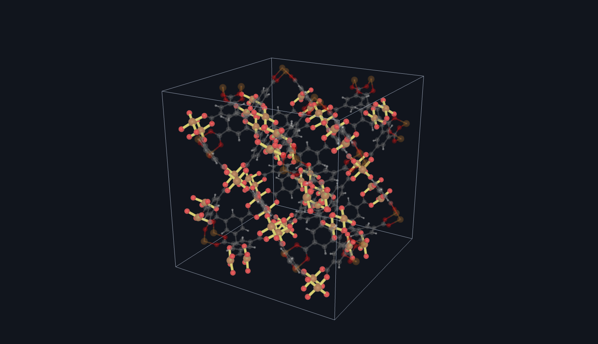
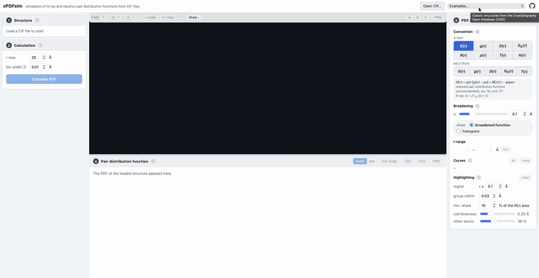

# xPDFsim

Simulation of X-ray and neutron pair distribution functions (PDFs) from CIF files, with an interactive
graphical user interface in the browser. Read the documentation [here](https://xpdfsim.readthedocs.io/en/latest/).



## Features

- Built-in CIF reader (symmetry expansion, partial occupancies, mixed sites, several structures per file)
- Simulation of R(r), ρ(r), g(r), G<sub>K</sub>(r), G(r), D(r), T(r) and N(r), defined as in Peterson *et al.*, [J. Appl. Cryst. 54, 317 (2021)](https://doi.org/10.1107/S1600576720015630)
- X-ray and neutron PDFs, with all element-element partial PDFs
- Graphical user interface: 3D structure viewer, instant switching between all functions, broadening
  or raw histogram, zoom and pan, export as CSV, SVG and PNG
- Click a region of the PDF to highlight the atom pairs that contribute most to it in the 3D viewer,
  with their share of the PDF
- Ten example structures from the Crystallography Open Database
- Export of the simulated PDFs to a CSV file from the command line
- Only one dependency: numpy

## Installation

Use the package manager [pip](https://pip.pypa.io/en/stable/) to install xPDFsim. Its only dependency is numpy.

```bash
pip install xPDFsim
```

## Usage

Simulate the PDF of a structure; the result opens in the graphical user interface in your browser:

```bash
xPDFsim example.cif
```

Calculate the neutron G(r) and save it as a CSV file, without opening the browser:

```bash
xPDFsim -p G_r --radiation neutron -o --no-plot example.cif
```

Start the graphical user interface without a file:

```bash
xPDFsim-gui
```



All options are listed with `xPDFsim -h`.

## Releasing

The documentation on Read the Docs is rebuilt automatically after every push to `main` (version
"latest") and for every new version tag (version "stable").

New versions are published on PyPI by the GitHub workflow `.github/workflows/publish.yml`:

1. Set the new version in `pyproject.toml` and describe the changes in `CHANGELOG.md`.
2. Push to `main` and publish a release on GitHub with the version as tag (e.g. `0.1.0` or `v0.1.0`).

The workflow checks that the tag matches the version, builds and tests the package and uploads it
with PyPI trusted publishing, so no password or API token is stored. One-time setup on pypi.org:
in the project `xPDFsim`, *Manage* → *Publishing* → *Add a new publisher* → GitHub, with owner
`JBWeiss-chem`, repository `xPDFsim`, workflow `publish.yml` and environment `pypi`.

## Contributing

Pull requests are welcome. For major changes, please open an issue first
to discuss what you would like to change.

## License

[GNU GPLv3](https://choosealicense.com/licenses/gpl-3.0/). The bundled three.js is licensed under the MIT
licence; the example structures from the COD are in the public domain.
