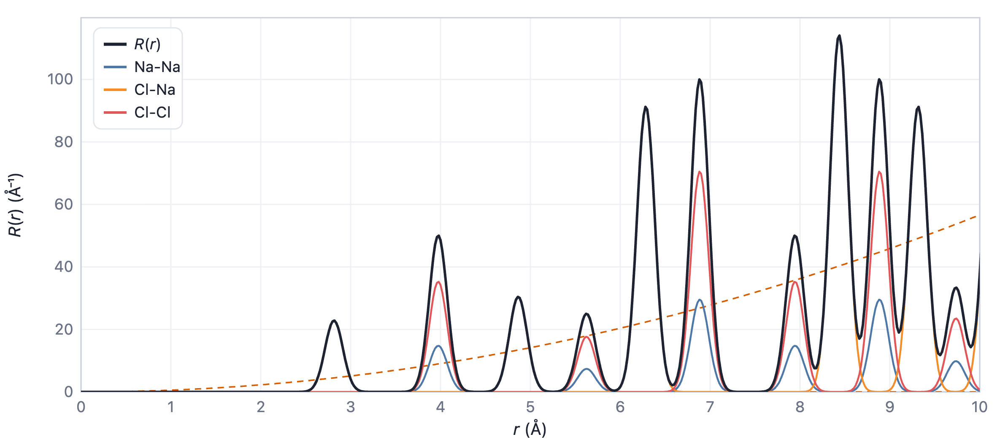
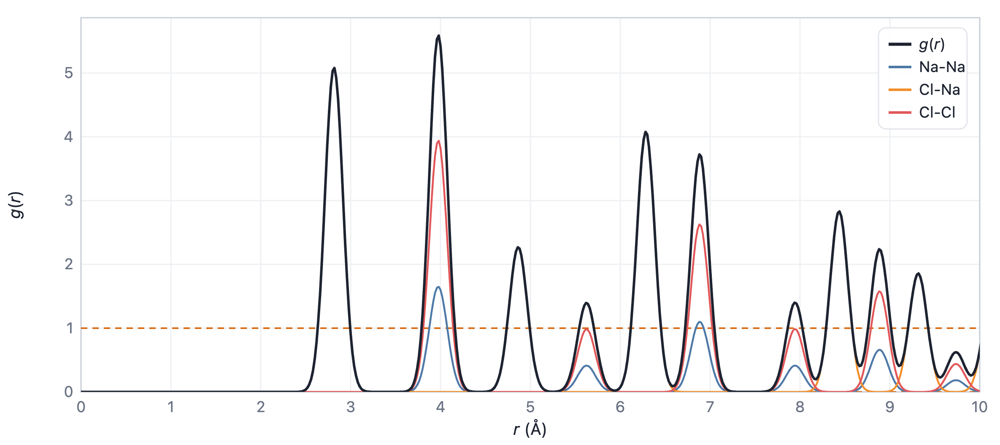
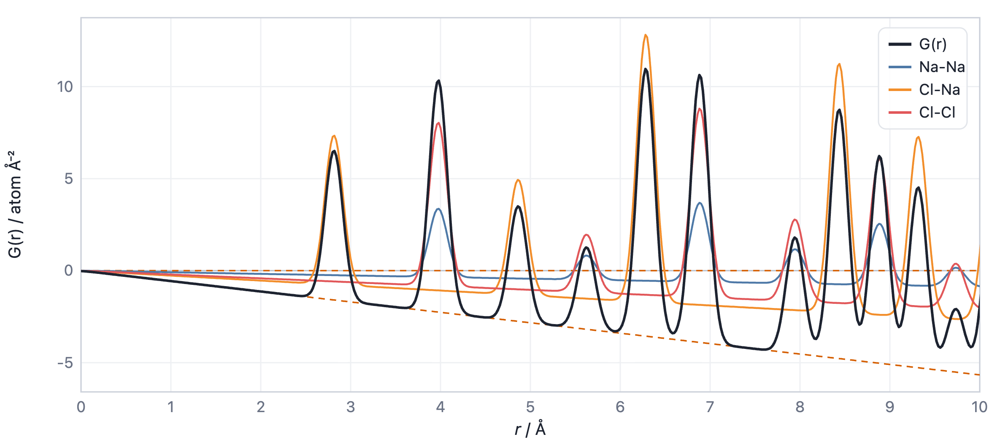

############
Introduction
############

***********************************
Various pair distribution functions
***********************************
There is a plethora of different pair distribution functions and various definitions. In this code, the definitions, names and units of Peterson *et al.* :sup:`1` are used, including the corrections of Peterson and Keen. :sup:`2` These build on the relations established by Keen. :sup:`3` xPDFsim calculates X-ray and neutron PDFs. For neutrons, :math:`b_i` is the coherent scattering length of element :math:`i` (*Neutron Data Booklet*, 2nd ed., 2003, with Sears' values). For X-rays, it is approximated by the X-ray scattering length at :math:`Q = 0`, :math:`b_i = Z_i r_\mathrm{e}`, with the atomic number :math:`Z_i` and the classical electron radius :math:`r_\mathrm{e}`; the :math:`Q` dependence of the atomic form factors is neglected. The radiation is chosen with the option ``--radiation`` (``xray`` or ``neutron``) or in the PDF options of the graphical user interface. Some elements, e.g. H, Ti and Mn, have negative neutron scattering lengths, so neutron partials can be negative.

All functions are calculated from the weighted radial distribution function (eq. 15 of Peterson *et al.*):

.. math::
  R(r) = \frac{1}{N} \sum_{\mu\nu} \frac{b_\mu b_\nu}{\langle b \rangle^2}\ \delta(r - r_{\mu\nu}),
  \qquad \langle b \rangle = \sum_i c_i b_i

where the sum runs over all pairs of atoms :math:`\mu \neq \nu` at the distance :math:`r_{\mu\nu}`, :math:`N` is the number of atoms in the unit cell and :math:`c_i` is the atomic fraction of element :math:`i`. In practice, the distances are sorted into histograms of width :math:`\mathrm{d}r` (option ``-b``), which are then broadened with Gaussians (option ``-s``).

   X-ray :math:`R(r)` of NaCl (COD 1000041) with its element–element partials and the asymptote :math:`4\pi\rho_0 r^2` (dashed), as shown by the graphical user interface.

:math:`R(r)` is very intuitive, but it grows as :math:`4\pi\rho_0 r^2` (with the average number density :math:`\rho_0`), which makes it impractical for plotting. The other functions follow from it (Table 5 and Appendix A of Peterson *et al.*):

.. list-table::
   :header-rows: 1

   * - Option ``-p``
     - Function
     - Definition
     - Low-r limit
     - High-r limit
     - Unit
   * - ``G_r``
     - reduced pair distribution function
     - :math:`G(r) = 4\pi r [\rho(r) - \rho_0]`
     - :math:`-4\pi\rho_0 r`
     - :math:`0`
     - Å\ :sup:`-2`
   * - ``g_r``
     - pair distribution function
     - :math:`g(r) = \rho(r) / \rho_0`
     - :math:`0`
     - :math:`1`
     - –
   * - ``D_r``
     - differential correlation function
     - :math:`D(r) = \langle b \rangle^2 G(r)`
     - :math:`-4\pi\rho_0 \langle b \rangle^2 r`
     - :math:`0`
     - barn Å\ :sup:`-2`
   * - ``GK_r``
     - total radial distribution function
     - :math:`G_\mathrm{K}(r) = \langle b \rangle^2 [g(r) - 1]`
     - :math:`-\langle b \rangle^2`
     - :math:`0`
     - barn
   * - ``R_r``
     - weighted radial distribution function
     - :math:`R(r)`
     - :math:`0`
     - :math:`4\pi\rho_0 r^2`
     - Å\ :sup:`-1`
   * - ``rho_r``
     - density function
     - :math:`\rho(r) = R(r) / 4\pi r^2`
     - :math:`0`
     - :math:`\rho_0`
     - Å\ :sup:`-3`
   * - ``T_r``
     - total correlation function
     - :math:`T(r) = \langle b \rangle^2 R(r) / r`
     - :math:`0`
     - :math:`4\pi\rho_0 \langle b \rangle^2 r`
     - barn Å\ :sup:`-2`
   * - ``N_r``
     - coordination number
     - :math:`N(r) = \int_0^r \mathrm{RDF}(r')\,\mathrm{d}r'`
     - :math:`0`
     - :math:`\tfrac{4}{3}\pi\rho_0 r^3`
     - –

   X-ray :math:`g(r)` of NaCl with its partials; it tends to 1 (dashed) at high :math:`r`.

Following Peterson *et al.*, :math:`g(r)` and :math:`G(r)` are the recommended functions: :math:`g(r)` is bounded by 0 and 1 and emphasises low-r features, while the oscillations of :math:`G(r)` have the same weight at all distances. :math:`g(r)` is the default function of the command line tool; the graphical user interface starts with :math:`G(r)`.

   X-ray :math:`G(r)` of NaCl with its partials and the asymptotes :math:`-4\pi\rho_0 r` below the first peak and 0 (dashed).

Partial functions
=================
Every function except :math:`N(r)` is written out with its element-element partials. They are given as the contributions of the element pairs to the total, i.e. the partial functions multiplied by the Faber-Ziman weights (Appendix F of Peterson *et al.*)

.. math::
  W_{ij} = c_i c_j \frac{b_i b_j}{\langle b \rangle^2}, \qquad \sum_{i,j} W_{ij} = 1,

so that the partials add up to the total, for example :math:`G(r) = \sum_{i,j} W_{ij} G_{ij}(r)` (eq. 66). The weights of the two orders of an unlike pair (e.g. Na-Cl and Cl-Na) are combined into one partial.

*******
Sources
*******
1. Peterson, P. F., Olds, D., McDonnell, M. T. & Page, K. Illustrated formalisms for total scattering data: a guide for new practitioners. *J. Appl. Cryst.* **54**, 317–332 (2021).
2. Peterson, P. F. & Keen, D. A. Illustrated formalisms for total scattering data: a guide for new practitioners. Corrigendum and addendum. *J. Appl. Cryst.* **54**, 1542–1545 (2021).
3. Keen, D. A. A comparison of various commonly used correlation functions for describing total scattering. *J. Appl. Cryst.* **34**, 172–177 (2001).
