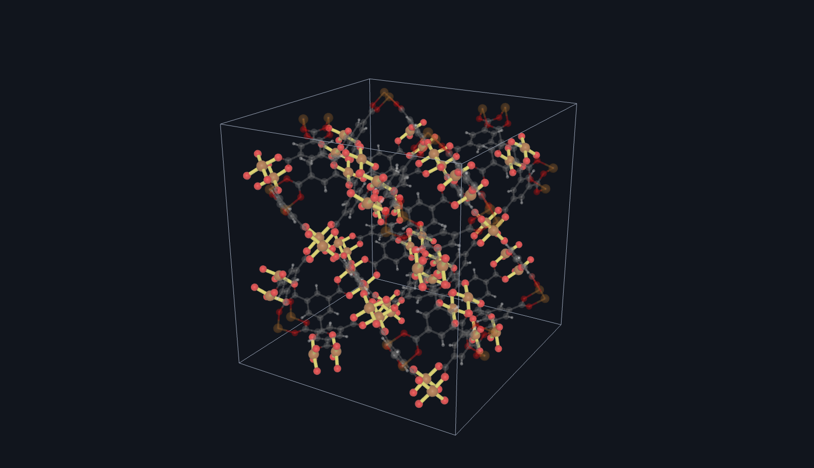
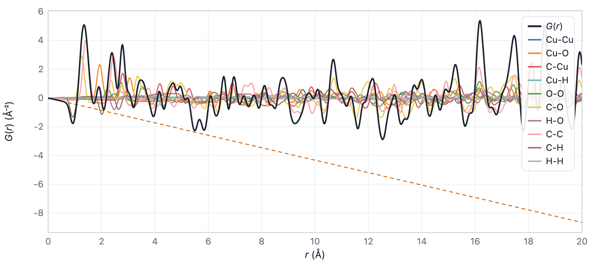

############
Usage
############

xPDFsim can be used from the command line and with a graphical user interface (GUI) that runs in your
browser. Both use the same calculation; the functions are explained in the Introduction.

************
Command line
************

Simulate the PDF of a structure by opening a terminal in the folder of your cif file (here *example.cif*) and typing:

.. code-block::

    xPDFsim example.cif

This calculates the PDF and shows it, together with the structure, in the graphical user interface, which opens in your default browser with the settings of the command line; press Ctrl+C in the terminal to stop it. All options are listed with:

.. code-block::

    xPDFsim -h

.. list-table::
   :header-rows: 1

   * - Option
     - Meaning
     - Default
   * - ``-p``, ``--pdf_type``
     - Function: ``G_r``, ``g_r``, ``D_r``, ``GK_r``, ``R_r``, ``rho_r``, ``T_r`` or ``N_r`` (see the Introduction)
     - ``g_r``
   * - ``--radiation``
     - ``xray`` or ``neutron``: the scattering lengths that weight the atom pairs
     - ``xray``
   * - ``-r``, ``--r_max``
     - Maximum distance in Å
     - 20
   * - ``-s``, ``--sigma``
     - Standard deviation of the Gaussian broadening in Å
     - 0.1
   * - ``-his``, ``--histogram``
     - Use the raw histogram instead of the broadened function
     - off
   * - ``-b``, ``--bin_width``
     - Width of the histogram bins in Å; rarely worth changing, it should be clearly smaller than σ
     - 0.01
   * - ``-o``, ``--output``
     - Save the function and its partials as a csv file in the current directory
     - off
   * - ``--no-plot``
     - Do not open the browser, e.g. in scripts that only save csv files
     - off

For example, this saves the neutron :math:`G(r)` without opening the browser:

.. code-block::

    xPDFsim -p G_r --radiation neutron -o --no-plot example.cif

The csv file is named after the cif file, the function and, for neutrons, ``_neutron``, e.g. *example_G_r_neutron.csv*. Its columns are the distance ``radii`` (in Å), one column per element pair (the partials, which add up to the total) and ``total``. The broadened functions are given on a grid of 0.02 Å up to r max, the histograms at the bin centres. Note that on file systems that do not distinguish upper and lower case (the default on macOS and Windows), *example_g_r.csv* and *example_G_r.csv* are the same file.

The command line reads cif files only. A file may contain several structures (data blocks); the command line tool uses the first one, the GUI offers all of them.

************************
Graphical user interface
************************

Start the GUI with:

.. code-block::

    xPDFsim-gui

It opens in your default browser (options: ``--port``, default 8766, ``--host`` and ``--no-browser``; if the port is in use, a free one is taken). Everything runs on your computer, also without an internet connection. The window has four numbered boxes around the 3D viewer: the structures (1), the calculation (2), the PDF options (3) and the plot of the PDF (4). The small *i* icons explain every part in detail. Controls that have no effect in the current state are greyed out.

Opening structures
==================
Open one or more cif files with the *Open CIF…* button or drop them anywhere on the window, or pick one of ten classic inorganic, organic and hybrid structures from the Crystallography Open Database (COD) in the *Examples…* menu.

3D viewer
=========
Drag to turn the structure, use the mouse wheel to zoom and the right mouse button to move it; *a*, *b* and *c* look along the lattice vectors, *PNG* saves the picture. 

   The 3D viewer with the Cu–O bonds of HKUST-1 highlighted (left-click on the first peak of the PDF); the rest of the structure is dimmed.

Calculation (box 2)
===================
The histograms are calculated up to *r max* with the *bin width* given here, for the whole unit cell. Only these two settings need a recalculation (*Calculate PDF*); everything else is applied instantly.

PDF options (box 3)
===================
* **Convention**: the function shown, for X-rays (upper rows: :math:`G(r)`, :math:`g(r)`, :math:`D(r)`, :math:`G_\mathrm{K}(r)`, :math:`R(r)`, :math:`\rho(r)`, :math:`T(r)`, :math:`N(r)`) or neutrons (lower row: the functions most used with neutrons). The box below the buttons gives the definition, the unit and :math:`\langle b \rangle^2` of the structure. Switching between functions is animated and needs no recalculation.
* **Broadening**: the standard deviation σ of the Gaussian broadening (up to 0.4 Å), and whether the broadened function or the histogram is shown. 
* **r range**: the range of the plot.
* **Curves**: the total and the element–element partials, and the asymptotes of the function (its low-r and high-r limits, Table 4 of Peterson *et al.*). Click a name to hide or show the curve. For X-rays, pairs with hydrogen are hidden at first, as H scatters X-rays weakly; for neutrons they are shown.
* **Highlighting**: the settings for highlighting distances in the viewer (see below).

Plot of the PDF (box 4)
=======================
Hover the plot to read off the values of all curves. In *zoom* mode (the default), drag across the plot to zoom into an r range; in *pan* mode, drag it to move the visible range. The mouse wheel zooms around the cursor in both modes, a double-click or *full range* shows the whole range. Click a name in the legend to hide or show the curve. *CSV*, *SVG* and *PNG* export the curves shown; the csv file has the format of the command line tool.

   Neutron :math:`G(r)` of HKUST-1 with its partials and asymptotes. The negative peak at 1 Å comes from the C–H bonds: H has a negative neutron scattering length.

Highlighting distances
======================
Left-click the plot to highlight the atom–atom distances that contribute most to the region around that distance (r ± the half-width set in box 3, or the histogram bins in it; shaded in orange). They are drawn as coloured rods in the viewer, while the rest of the structure is dimmed; the highlighting stays while you turn the structure. Click into the highlighted region or press Esc to remove it.

Every highlighted distance is listed in the viewer with its share of the area under the pair density :math:`R(r)` in the region. :math:`R(r)` is never negative, so the shares of all distances add up to 100 % in every convention. With neutrons, pairs with a negative product of scattering lengths (e.g. with H, Ti or Mn) contribute negatively; the shares then refer to the area under :math:`|R(r)|` and such distances are marked *negative*. All symmetry-equivalent pairs of a distance are highlighted. The colours are colour-blind safe; the stronger a distance, the brighter its colour.

Chemically nearly identical distances are grouped and highlighted together, e.g. the six Zn–N bonds of the two Zn sites of ZIF-4 (1.977–1.997 Å): a group holds the distances of one element pair that differ by at most the *group width* (default 0.03 Å) from the shortest one of the group. Symmetry-equivalent pairs always count as one distance.

The settings in box 3: the half-width of the *region*, the *group width* (0: no grouping), the *minimum share* of a highlighted group (default 10 %; at most eight groups are highlighted), the *rod thickness* and the visibility of the *other atoms* (far left: hidden). Partials that are hidden in the plot are not highlighted.
